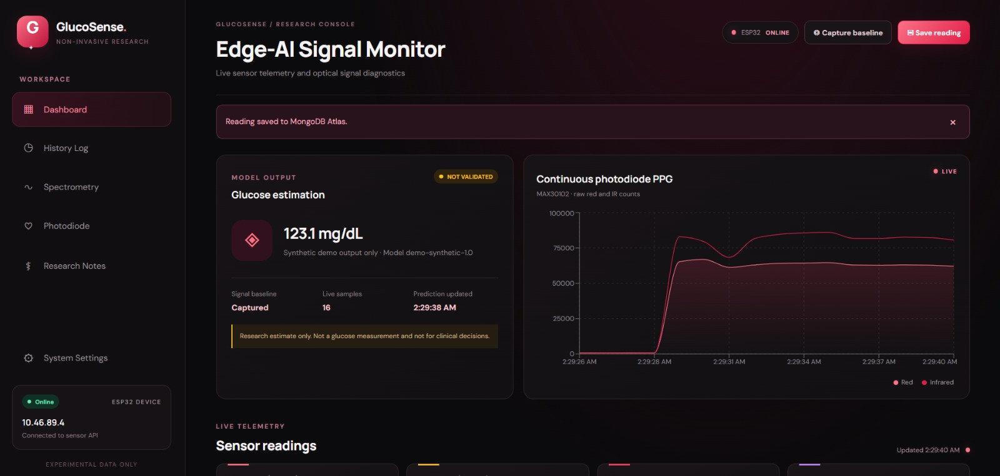
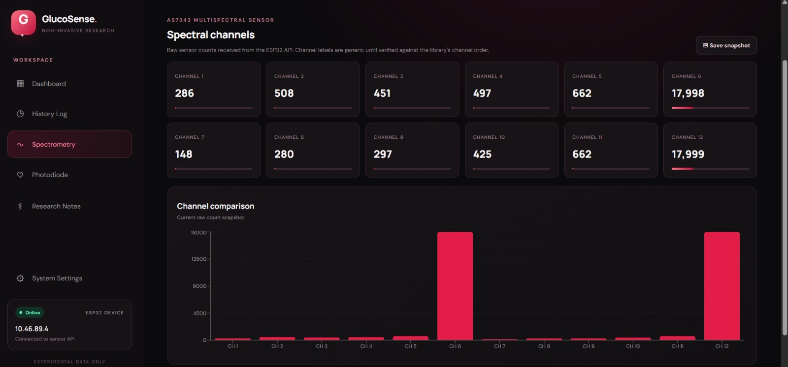
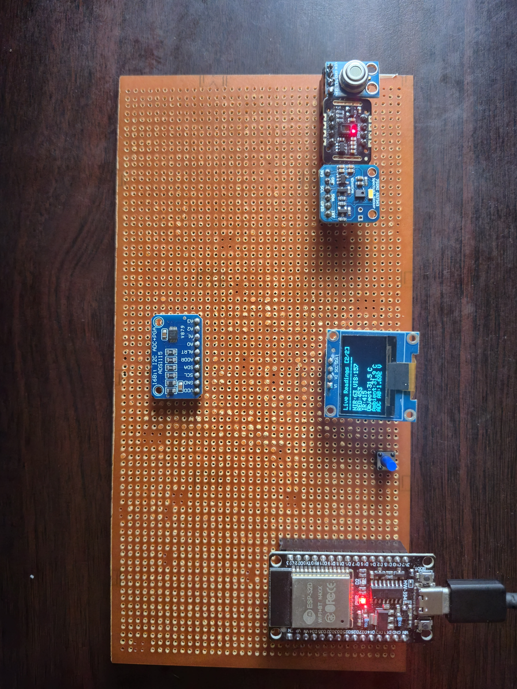
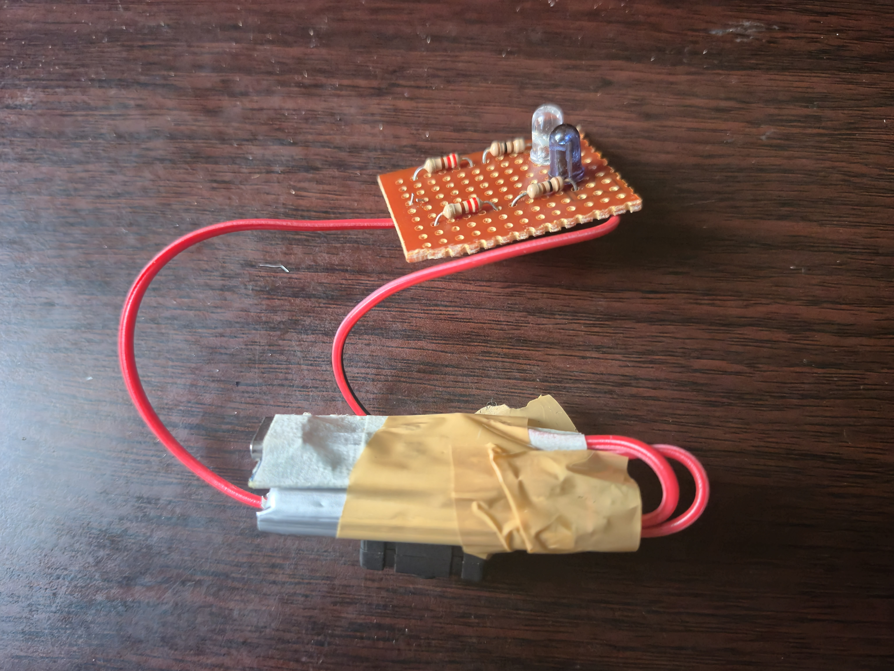
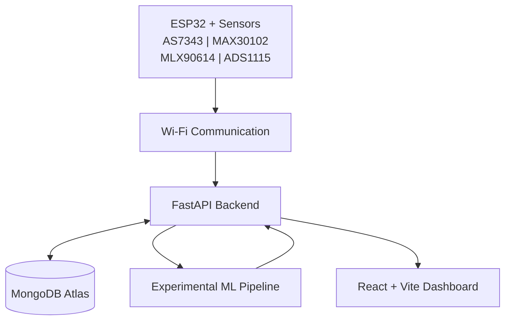

# GlucoSense – Non-Invasive Glucose Monitoring System


&nbsp;


<p align="center">
  <strong>An Experimental IoT and Machine Learning Research Prototype</strong>
</p>

GlucoSense is an experimental non-invasive glucose monitoring research project that explores the use of optical sensing, physiological signals, IoT hardware, and Machine Learning for glucose estimation.

The system integrates an ESP32-based sensor platform with a full-stack web application, cloud database, and an experimental ML pipeline to collect, process, visualize, and analyze sensor readings.

> **Disclaimer:** GlucoSense is an experimental research prototype, not a clinically validated medical device. Its estimated glucose values must not be used for diagnosis, treatment, insulin dosing, or medical decisions.

## Key Features

- ESP32-based sensor data acquisition.
- Multispectral optical sensing using AS7343.
- NIR sensing experiments using 850 nm and 940 nm LEDs.
- PPG signal acquisition using MAX30102.
- Temperature monitoring using MLX90614.
- Real-time sensor telemetry and visualization.
- FastAPI-based backend services.
- MongoDB Atlas database integration.
- Experimental Machine Learning regression pipeline.
- Interactive React dashboard.
- Historical sensor reading management.

## Dashboard Preview

### Live Dashboard – Edge-AI Signal Monitor



The dashboard displays ESP32 connectivity, experimental model output, live PPG signals and sensor telemetry.

### Spectrometry – AS7343 Multispectral Sensor



Displays 12 spectral channel readings and their comparative visualization.

> Note: The displayed glucose estimate is experimental and not clinically validated.

## Hardware Implementation

### Complete GlucoSense Hardware Setup

The prototype integrates ESP32-based sensor acquisition, optical sensing modules, an ADC interface and an OLED display on a prototyping board.



### NIR LED Illumination Setup

The experimental optical illumination setup uses 850 nm and 940 nm near-infrared LEDs with current-limiting resistors.




## Hardware Components

| Component | Purpose |
|---|---|
| ESP32 DevKit V1 | Main microcontroller |
| AS7343 | Multispectral optical sensing |
| MAX30102 | PPG and pulse signal acquisition |
| MLX90614 | Infrared temperature measurement |
| ADS1115 | 16-bit ADC |
| SSD1306 OLED | Sensor status and readings display |
| 850 nm / 940 nm LEDs | Near-infrared illumination |

## Technology Stack

**Embedded Systems**
- ESP32
- Arduino IDE
- I2C communication
- Sensor interfacing

**Backend**
- Python
- FastAPI
- Pydantic
- REST APIs

**Database**
- MongoDB Atlas
- PyMongo

**Frontend**
- React
- Vite
- JavaScript / TypeScript
- Recharts

**Machine Learning**
- Python
- NumPy
- Pandas
- Scikit-learn
- Joblib


## System Architecture




## Machine Learning Pipeline

GlucoSense contains two separate machine learning workflows.

### 1. Synthetic Demonstration Model

- Algorithm: Random Forest Regressor
- Training samples: 6,000 synthetic records
- Input features: 16
- Purpose: Dashboard and API functionality testing
- Model version: demo-synthetic-1.0

This model uses artificially generated sensor features and synthetic target values. It is not trained on actual human glucose measurements.

### 2. Reference-Labelled Experimental Training Pipeline

A separate training script retrieves sensor observations with reference glucose labels from MongoDB.

It evaluates:
- ExtraTrees Regressor
- Random Forest Regressor
- HistGradientBoosting Regressor

Models are compared using MAE, RMSE and R².

### Model Evaluation Results

| Model | MAE | RMSE | R² |
|---|---:|---:|---:|
| Mean Baseline | 12.9004 | 22.0583 | -0.0075 |
| Ridge Regression | 12.9174 | 22.0096 | -0.0030 |

Note: These metrics are from a separately reported evaluation CSV and are not verified as the output of the current training.py script.

### Important Limitations

- Synthetic predictions do not represent actual glucose measurements.
- Reference-labelled training requires reliable human reference glucose data.
- Negative R² scores indicate poor performance in the reported evaluation.
- Independent validation is required before making any glucose prediction accuracy claims.

GlucoSense is an experimental research prototype, not a clinically validated medical device.


## Project Structure

```text
GlucoSense/
│
├── backend/
│   ├── app/
│   │   └── ml/
│   ├── artifacts/
│   │   └── glucosense_model.joblib
│   ├── requirements.txt
│   └── .env.example
│
├── frontend/
│   ├── src/
│   ├── package.json
│   └── .env.example
│
├── firmware/
│   └── GlucoSense_ESP32.ino
│
├── README.md
└── .gitignore
```

## Installation and Setup

### 1. Clone the Repository

```bash
git clone https://github.com/bhushan1395/GlucoSense.git
cd GlucoSense
```

### 2. Backend Setup

```bash
cd backend

python -m venv .venv
```

Activate the environment on Windows:

```powershell
.venv\Scripts\activate
```

Install dependencies:

```bash
pip install -r requirements.txt
```

Create your environment file:

```powershell
Copy-Item .env.example .env
```

Configure your MongoDB URI and other required environment variables in `.env`.

Start the backend:

```bash
uvicorn app.main:app --reload --host 127.0.0.1 --port 8000
```

API health check:

```text
http://127.0.0.1:8000/health
```

Interactive API documentation:

```text
http://127.0.0.1:8000/docs
```

### 3. Frontend Setup

Open another terminal:

```bash
cd frontend
npm install
```

Create the frontend environment file if required:

```powershell
Copy-Item .env.example .env
```

Start the development server:

```bash
npm run dev
```

Open the local URL displayed by Vite.

### 4. ESP32 Firmware Setup

1. Open `firmware/GlucoSense_ESP32.ino` in Arduino IDE.
2. Install the required sensor libraries.
3. Configure Wi-Fi credentials and device API key locally.
4. Select ESP32 DevKit V1 and the correct COM port.
5. Compile and upload the firmware.
6. Check sensor communication using Serial Monitor.

## API and Database

The FastAPI backend provides REST endpoints for sensor telemetry, database interaction, and model-related operations.

MongoDB Atlas is used for storing sensor readings and associated project data.

The API documentation is available through FastAPI Swagger UI at `/docs` when the backend is running.

## Future Scope

- Improve sensor calibration and signal quality.
- Collect larger datasets with reliable reference glucose labels.
- Conduct independent model validation.
- Explore additional regression algorithms.
- Improve optical sensor placement and hardware integration.
- Optimize real-time data processing.
- Evaluate performance across different users and conditions.

## Research and Safety Disclaimer

GlucoSense is developed for educational and research purposes.

It is not a certified or clinically validated glucose monitoring device. Optical and physiological sensor readings do not directly measure blood glucose. Experimental predictions must not replace standard glucose measurement devices or professional medical advice.
## 🎥 Working Demonstration
[▶ Download GlucoSense Working Demo](https://github.com/bhushan1395/GlucoSense/releases/download/v1.0.0/20261102_145314_1.mp4)
## Author

**Bhushan Bhatkar**

Electronics and Telecommunication Engineering

GitHub: https://github.com/bhushan1395

LinkedIn: https://www.linkedin.com/in/bhushan-bhatkar/

---

**Project:** GlucoSense – Non-Invasive Glucose Monitoring System

**Category:** IoT | Embedded Systems | Full Stack Development | Machine Learning
